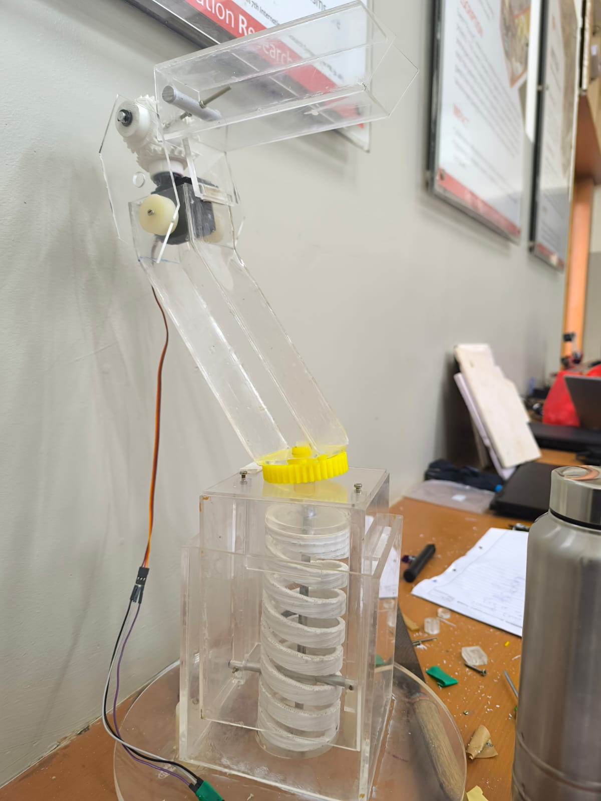
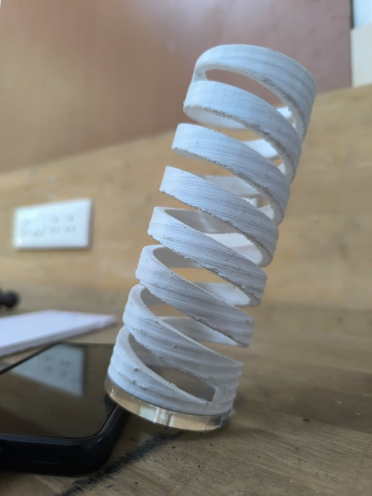
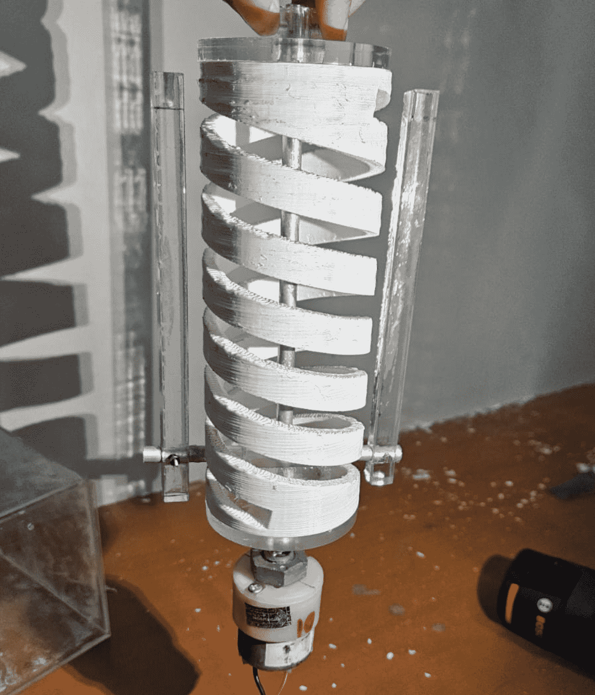
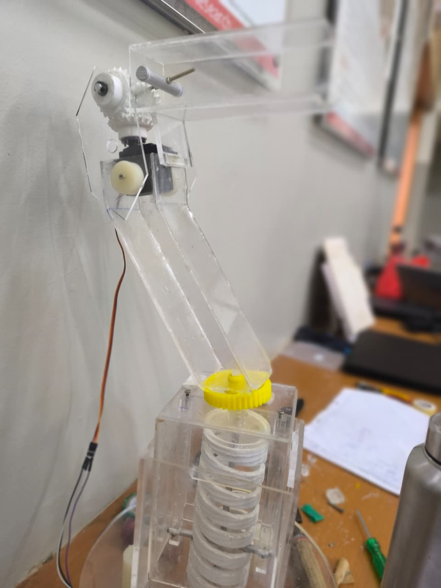

# Monitor Gimbal

**A dual-axis automated monitor mount that pans and tilts the screen toward the user.**

Built as a first-semester Engineering Exploration project, the gimbal combines an ESP32 controller, servo and stepper motors, and a 3D-printed transmission inside a laser-cut acrylic frame.



## Overview

The goal was a smart mount that could hold a tablet-sized display and rotate it horizontally and vertically on command, keeping the screen facing the user. The prototype was developed against a ₹5,000 budget using non-toxic, sustainable materials, in three agile sprints: structure and base, dual-axis drive, then testing and integration.

## At a glance

| | |
|---|---|
| **Degrees of freedom** | 2 — horizontal pan and vertical tilt |
| **Target range** | 180° per axis |
| **Controller** | ESP32 DevKit |
| **Actuators** | Stepper motor (base), servo motor (screen bracket) |
| **Transmission** | Barrel cam, worm gear, bevel gears |
| **Structure** | 3D-printed parts, acrylic frame and guides |
| **Budget** | Under ₹5,000 |
| **Load** | Tablet-sized display |

## How it works

The mount separates into a fixed base and a moving arm that carries the screen bracket.

- **Horizontal movement** — a stepper motor drives a worm gear reduction, turning the arm while holding its position against the load.
- **Vertical movement** — a barrel cam converts rotation into controlled linear motion along acrylic guides. A servo and bevel gears at the top of the arm set the final tilt of the screen bracket.
- **Control** — ESP32 firmware written in C drives both motors in response to position commands, coordinating the two axes.

## Mechanisms

### Barrel cam

The 3D-printed helical barrel cam is the core of the vertical axis. A follower rides in the groove, so one revolution produces one controlled vertical stroke. The shallow helix and large contact area give smooth motion and resist back-driving.





### Worm gear

The worm gear provides a high gear reduction for horizontal rotation in a compact package. Its self-locking behaviour lets the arm hold an angle instead of drifting under the weight of the display.

### Bevel gears

Bevel gears transfer the drive through 90° at the top of the arm, linking the tilt servo to the screen bracket.



## Electronics

| Component | Role |
|---|---|
| ESP32 DevKit | Main controller, receives position commands |
| Stepper motor | Drives the barrel cam / horizontal axis |
| Servo motor | Sets the screen tilt |
| Motor driver and external supply | Stepper drive and shared power |

The ESP32 firmware was written in C during the build.

> [!NOTE]
> This repository currently documents the hardware and mechanical design. The original firmware source is not included.

## Results

- A working dual-axis monitor gimbal prototype.
- Controlled horizontal and vertical movement with a target range of 180° per axis.
- Mechanical and electronic subsystems integrated into a single unit.
- Demonstrated embedded control, motor selection, and transmission design in a first-year project.

## Challenges and lessons

- **Alignment over power.** Misaligned gears and cam followers cost more motion than a bigger motor gains. Getting the shafts parallel and the follower centred in the groove mattered most.
- **Printed tolerances add up.** Clearances that look right in CAD can bind after printing, so the mechanism needed reaming, shimming, and reprinted parts.
- **Light and stiff is a trade-off.** The acrylic frame keeps weight down, but every joint has to resist the torque of a screen held out on an arm.
- **Test each axis alone first.** Debugging pan and tilt together hides which mechanism is actually slipping.

## My role

This was a team project for the Engineering Exploration course. My contributions:

- ESP32 embedded development in C.
- Servo and stepper motor control for dual-axis movement.
- Mechanical design and implementation of the barrel cam, worm gear, and bevel gear mechanisms.
- Circuit wiring, structural assembly, and prototype development.
- System testing and integration through sprint-based iterations.

## Links

- [LinkedIn write-up](https://lnkd.in/p/djKTKzCp)
- [GeeksforGeeks project post](https://www.geeksforgeeks.org/connect/post/92835/a-remote-controlled-monitor-stand-in-my-first-year-of-engineering-this-was-exactly-my-course-projec/)
- [GeeksforGeeks discussion: assumptions that changed after the prototype](https://www.geeksforgeeks.org/connect/post/96410/whats-one-design-assumption-you-only-realized-was-wrong-after-building-the-prototype-for-me-when-w/)

## Repository contents

```text
.
├── images/
│   ├── prototype.jpeg
│   ├── prototype-side.jpeg
│   ├── barrel-cam.jpeg
│   └── barrel-cam-assembly.png
└── README.md
```
